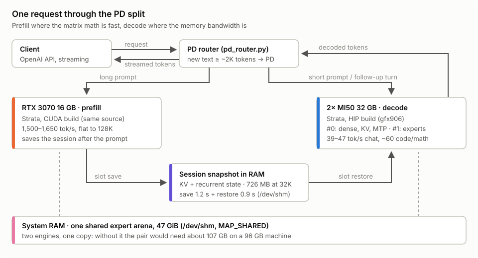
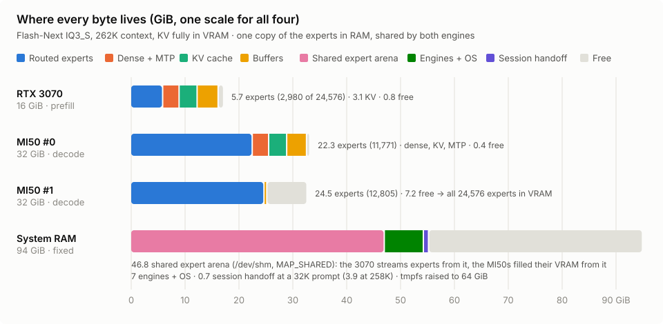
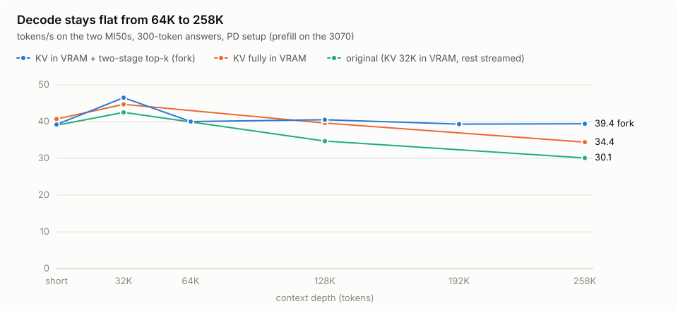

# PDHyperMix-Strata-MI50

**English** · [繁體中文](README.zh-TW.md) · [简体中文](README.zh-CN.md)

**Prefill / decode disaggregation on a single machine: a high-memory-bandwidth GPU handles decode, a matrix-strong GPU handles prefill.**

[How it works](#how-it-works) · [Benchmarks](docs/BENCHMARKS.md) · [Deploy](docs/DEPLOY.md) · [Known issues](docs/LESSONS.md)

The docs are written in Traditional Chinese; Simplified Chinese versions are the `docs/*.zh-CN.md` files.

## Overview

PD disaggregation is normally deployed on multi-node data-center clusters linked by RDMA. This project runs the same
architecture on one machine. The reference setup is 2× AMD Instinct MI50 with one RTX 3070, the inference engine is
[Strata](https://github.com/Niko1221/Strata), and the model is Qwen3.8-Flash-Next IQ3_S.

| Metric | MI50 only | PDHyperMix |
|---|---|---|
| Prefill, 32K prompt | ~400 tok/s | **~1,600 tok/s** |
| Decode, 64K–258K | 30–35 tok/s | **39–40 tok/s** |
| TTFT, 32K prompt | ~80 s | **~24 s** |
| Total time, 32K prompt and a 200-token answer | 85.2 s | **27.8 s** |

This project provides:

- The PD disaggregation architecture and memory layout
- Dockerfiles, configuration and launch scripts ready to use
- A gfx906 decode change to Strata: a two-stage indexer top-k, on the fork branch
  [`gfx906-ep`](https://github.com/MarcoTool/Strata/tree/gfx906-ep), to be submitted upstream as a PR

It has been verified on the setup above only. Adjustments for other hardware are described in [DEPLOY](docs/DEPLOY.md).

## Design

### GPU pairing

Prefill and decode place different demands on hardware. Prefill is large-batch matrix math and depends on matrix
units; decode is mostly limited by memory bandwidth and VRAM capacity. Once the two stages are split, each can run on
the GPU best suited to it.

The MI50 has 32 GB of HBM2 and about 1 TB/s of rated bandwidth; two cards hold all 24,576 experts of Flash-Next in
VRAM. gfx906 has no matrix units such as MFMA: two cards prefill a 32K prompt at about 400 tok/s, and a layer-split
prefill reaches only 625 tok/s. With an RTX 3070 handling prefill, prefill rises to 1,500–1,650 tok/s and the MI50s
handle decode only. Each side can be upgraded independently.

Other pairings of a decode-strong and a prefill-strong GPU should work the same way in principle; they have not been
measured.

### Engine

The reference implementation uses Strata. Strata can save and load sessions, and one source tree builds both a CUDA
and a HIP backend, so a session can be handed off between the two backends.

### Contents of the fork branch

The fork branch [`gfx906-ep`](https://github.com/MarcoTool/Strata/tree/gfx906-ep) is based on upstream Strata 0.1.43.1
and contains the commits below. Every number on this page was measured with this branch's code.

| Commit | Change | Used by PDHyperMix |
|---|---|---|
| [`6d07261`](https://github.com/MarcoTool/Strata/commit/6d072612) | Two-stage indexer top-k on gfx906, enabled by `STRATA_GFX906_TOPK_SPLIT=1` | Yes |
| [`2d8a158`](https://github.com/MarcoTool/Strata/commit/2d8a1582) | Layer-split prefill prototype on gfx906, enabled by `STRATA_GFX906_SPLIT_PREFILL` | No; off by default and does not affect results |
| [`c94d134`](https://github.com/MarcoTool/Strata/commit/c94d134f) | English documentation for the components above | Documentation only, no code |

The layer-split prefill prototype is an experiment from before the move to PD disaggregation, aimed at faster prefill on
the MI50s alone. It is kept so that the branch matches the measured build exactly.

## How it works

- **Prefill**: the RTX 3070 runs Strata's CUDA build.
- **Decode**: the 2× MI50 run Strata's HIP gfx906 build, with every expert resident in VRAM.
- **Session handoff**: after prefill, the 3070 saves the KV and recurrent state to a session file, and the MI50s load
  it and continue with decode. A 32K prompt's session is about 726 MB and the handoff through RAM takes about 2.2 s.



Three things make PD disaggregation work on a single machine:

1. **One copy of the experts in RAM.** IQ3_S has about 47 GiB of experts; one copy per engine would exceed the 96 GB
   of RAM. Strata's `--shared-expert-arena` places the experts in a shared file in `/dev/shm`, mapped by both engines.
2. **Both engines built from one source tree.** A session carries a fingerprint of the engine settings; the version,
   the KV format and `--kv-resident` must match on both sides for the handoff to succeed.
3. **Session handoff through RAM.** Strata writes sessions with `O_DIRECT` and `fsync`. Saving and loading a 32K
   session takes 4.8 s on a SATA SSD and 2.2 s in `/dev/shm`.

## Memory layout



| Device | Contents |
|---|---|
| RTX 3070 | Dense layers, MTP, the full 262K KV, 2,980 experts; the remaining experts are streamed from RAM during prefill |
| MI50 #0 | Dense layers, KV, MTP, 11,771 experts |
| MI50 #1 | 12,805 experts; the two cards cover all 24,576, so decode reads no experts from RAM |
| RAM | Shared expert arena 46.8 GiB, both engines and the OS about 7 GiB, the session file |

## Decode-side optimizations

With the original settings, decode drops to 30 tok/s at 258K context. Two changes were made:

- **The whole KV in VRAM.** With `--kv-resident 262144`, the KV at 262K is 3.1 GiB and the experts it displaces move
  to MI50 #1. Every context length gains 4–14%.
- **A two-stage indexer top-k on gfx906.** Enabled by `STRATA_GFX906_TOPK_SPLIT=1` and requires the fork branch. The
  original implementation used a single 256-thread CTA per query, which took 12 ms of every window at 258K; the
  rewrite returns bit-identical results and makes this step 6× faster.



## Benchmarks

Strata's prefill speed barely changes with context length. Results for this setup:

| Prompt length | Prefill tok/s | Decode tok/s | TTFT |
|---|---|---|---|
| 16K | 1,533 | 43.8 | 12.2 s |
| 32K | 1,597 | 46.5 | 22.5 s |
| 64K | 1,681 | 40.0 | 42.4 s |
| 128K | 1,643 | 40.5 | 85.6 s |
| 192K | 1,589 | 39.3 | 132.6 s |
| 258K | 1,543 | 39.4 | 179.8 s |

Conditions: the whole KV in VRAM, the two-stage top-k enabled, 300 tokens generated per run. TTFT is prefill plus the
session handoff and excludes the 0.1–0.3 s the decode side spends on the few tokens after loading the session.

Decode speed by task type at short context: chat 47.3 tok/s, code 60.6 tok/s, math 60.6 tok/s.

Against community results for the same engine and quantization, compared with a single R9700 32 GB, this setup
prefills 2.1–2.3× faster and decodes at about half the speed, 46.5 vs 95.6 tok/s. The full comparison and methods are
in [BENCHMARKS](docs/BENCHMARKS.md#與其他硬體的單請求對照).

## Test hardware

| Component | Spec |
|---|---|
| Decode | 2× AMD Instinct MI50 32 GB, gfx906, sclk capped at 1,339 MHz, power capped at 170 W |
| Prefill | NVIDIA RTX 3070 16 GB, modified board with FP16/BF16 unlocked, see [BENCHMARKS](docs/BENCHMARKS.md#prefill-卡) |
| CPU / board | AMD Threadripper 1920X, ASUS PRIME X399-A, PCIe 3.0 |
| RAM | 96 GB |
| Storage | SATA SSD |
| Software | Ubuntu 22.04, kernel 6.8, ROCm 7.14, NVIDIA driver 580, CUDA 13 |

## Verified combinations

| Decode | Prefill | Status |
|---|---|---|
| 2× MI50 32 GB | RTX 3070 16 GB | Measured, the numbers on this page |

Other combinations have not been verified, for example an RTX 20 / 40 / 50 series card for prefill, or an MI60 or
Radeon VII for decode; the CUDA image includes these NVIDIA architectures by default. Results from `bench_tasks.py` and
`bench_depth.py` are welcome as an issue, or as a PR that adds a row to this table.

## Requirements

| Item | Requirement |
|---|---|
| RAM | About 72 GB or more for IQ3_S: shared expert arena 47 GiB, both engines about 15 GB, OS about 4 GB, session file up to about 4 GB |
| Prefill GPU | For IQ3_S at 262K context, dense layers, KV, MTP and buffers take about 9.5 GiB; 12 GB or more is recommended |
| Decode GPU | VRAM must hold every expert; 2× MI50 32 GB just fit IQ3_S |

These thresholds are estimates and have not been measured.

## Quick start

```bash
git clone https://github.com/MarcoTool/PDHyperMix-Strata-MI50.git
git clone -b gfx906-ep https://github.com/MarcoTool/Strata.git strata-src

cd PDHyperMix-Strata-MI50/scripts
cp pd.env.example pd.env        # point STRATA_SRC at strata-src; set the data paths and GPU indices
./pd_build.sh                   # build the prefill and decode images from the same source tree
./pd_up.sh                      # start the prefill engine, the decode engine and the router
./pd_down.sh --free-arena       # stop the services and free the shared expert arena
```

Once started, the service provides an OpenAI-compatible endpoint at `http://127.0.0.1:20030/v1`. No prebuilt images
are provided; `pd_build.sh` builds them locally from `docker/Dockerfile.cuda` and `docker/Dockerfile.gfx906`. Model
download and the full steps are in [DEPLOY](docs/DEPLOY.md).

## Routing

The router's `PD_MIN_CHARS` decides whether a request is read on the prefill card first: when the new text reaches that many characters, the prefill engine reads the prompt and hands the session over; otherwise the decode engine handles the request itself. The default is `0`, so every text request goes through the prefill card. The prefill engine reuses its KV for the earlier turns and reads only the new part, and the decode engine starts generating right after loading the session.

Measured in an agent-like loop, a 16K document followed by turns that each add about 500 tokens of tool output: with `PD_MIN_CHARS` at 6000 these short additions stayed on the decode engine, 5.4–12.2 s a turn, 8.5 s on average; with `0`, 5.3–5.8 s a turn, 5.5 s on average.

## Image input

With `MMPROJ` set in `pd.env`, both engines get image input. The prefill engine's image encoder runs on its GPU and the decode engine's on the CPU, since the MI50s' VRAM is taken by the experts. Both engines need `--vision`: it is part of the session fingerprint, and the handoff fails if either side lacks it.

The router's `PD_IMAGES` decides which engine reads a conversation's images:

| Value | Behaviour | Small image, measured |
|---|---|---|
| `decode` (default) | Any conversation with an image goes straight to the decode engine, whose CPU encoder reads it | 4.6 s |
| `prefill` | A new image goes to the prefill engine's GPU encoder first, then the session is handed over | 14.1 s |

`prefill` is slower because each engine encodes the images again before it decides how much of the session it can reuse. The GPU and CPU encoders do not give bit-identical results, so the decode engine cannot reuse the session past the image and reads the whole prompt again. Text-only requests ignore `PD_IMAGES`; long prompts still go to the prefill card.

## Known limitations

- Each engine serves one request at a time; session save/load and parallel request mode exclude each other. Two
  concurrent requests finish only 16% sooner overall.
- Output is not guaranteed to be reproducible token for token, because CUDA and HIP round floating point differently.
- Any other Strata process started while PD is running must use the same `--shared-expert-arena`, or it allocates
  about 47 GB more RAM.

The full list and troubleshooting are in [LESSONS](docs/LESSONS.md).

## Repository layout

```
assets/    architecture figures
docker/    Dockerfiles for the prefill and decode engines
docs/      deployment, benchmarks, known issues
scripts/   router, engine configuration, build, launch and benchmark scripts
```

## License and acknowledgements

This project is released under the MIT License; see [LICENSE](LICENSE). The inference engine is
[Strata](https://github.com/Niko1221/Strata), MIT License, © Niko1221 and the Strata contributors.
